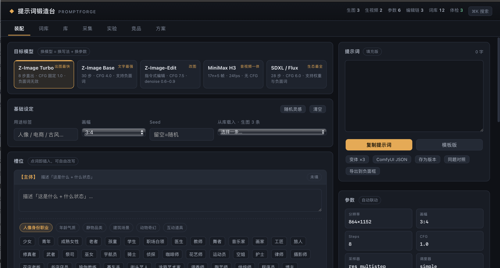

# PromptForge · 提示词锻造台

> 一个把「提示词」当工程对象来管理的桌面工具：槽位是输入，模型是编译器。
> A local-first prompt workbench for text-to-image / text-to-video models, shipped as a native macOS & iOS app.

写提示词最容易踩的坑不是「词不够多」，而是：**同一个 prompt 换一个模型就废了**。
Turbo 的 CFG 不能调、H3 的帧数必须 17n+5、Base 才吃得下负面词、Edit 的指令不能复述原图……
这些是硬约束，不是风格偏好。PromptForge 把这些约束写进工具里：选模型 → 填槽位 →
自动按该模型的规则拼段落、算帧数、查违规、生成 ComfyUI 参数，最后给出可复制的成品。



---

## 开发目的

做了几百条生图 / 生视频提示词之后，会遇到三个具体问题：

1. **沉淀不住**。散在备忘录、微信收藏、笔记软件里，找不到、比不了、复用不了。
2. **换模型就失效**。Z-Image Turbo 没有负向、CFG 锁死 1.0；MiniMax H3 没有 CFG、帧数必须
   `17n+5`、结尾不写声音就静音。这些规则靠脑子记，一定会错。
3. **改一处崩一片**。改主体忘了改槽位清单，改风格忘了改参数，导出的 ComfyUI 参数与提示词对不上。

所以这个工具的目标不是「帮你写得更花」，而是**让每一版提示词都是可校验、可复现、可迁移的工程产物**：
槽位与正文一致、参数与模型匹配、规则违规当场提示、换模型自动重排段落。

配套的提示词全量库（300+ 条实测条目）属于作者私有资产，**不随本仓库分发**；
仓库内只保留 5 条示例条目用于试用与演示，见 [数据说明](#数据说明)。

---

## 功能

| 模块 | 作用 |
|---|---|
| **装配** | 选目标模型 → 五张模型卡（步数 / CFG / 负面词是否有效一目了然）→ 填四个槽位 → 实时预览、长度预算、违规体检、一键复制。槽位是输入，段落顺序、参数基线、分辨率表由模型决定。 |
| **词库** | 按「槽位 × 维度」组织的词汇表，10 个段落全覆盖：主体 / 人物特征 / 服饰造型 / 动作行为 / 场景环境 / 镜头 / 光影 / 风格 / 画质 / 声音，共 101 维 2125 词，点击即复制。 |
| **库** | 条目检索、按评分与标签筛选、产出次数统计、相似条目反查、版本树与段级 diff。 |
| **采集** | 粘贴任意来源的 prompt（含 MJ 的 `--ar`、SD 的 `(xxx:1.2)`、负面词），自动清洗来源噪音、负面转正面、拆进槽位、与库内查重、给出建议评分，审核通过后导出补丁 CSV。也支持从 ComfyUI / WebUI 生成的 PNG 里直接读元数据。 |
| **实验** | 变体对照、A/B 矩阵（多变量组合）、ComfyUI 工作流 JSON 生成、负向词映射（正负双向转换）、失败案例库关联。 |
| **竞品** | 同类工具的能力矩阵与差距分析（PromptLayer / promptfoo / PromptHero / OpenArt 等），用于判断该补什么、不该做什么。 |
| **方案** | 版本路线、已知边界、刻意不做的功能，以及本工具的设计取舍说明。 |

---

## 适配的模型

工具内置五个模型的参数基线，切换模型会同时改变**段落顺序、参数默认值、分辨率表和校验规则**。

| 模型 | 步数 | CFG | 采样器 | 负面提示词 | 关键硬约束 |
|---|---|---|---|---|---|
| **Z-Image Turbo** | 8（6–11） | **1.0，不可调** | res_multistep + simple | **无效**（需 ConditioningZeroOut） | 约 4MP 上限；宽高必须是 16 的倍数；否定词一律改正面描述 |
| **Z-Image Base** | 30 | 4.0 | euler + simple | 支持 | 文字排版 / 信息图 / UI / PPT 类首选；长 prompt 更稳 |
| **Z-Image Edit** | 25–30 | 7.5（7–9） | euler | — | 指令只写「要改成什么」，不复述要保留的主体；denoise 0.6–0.9；蒙版边缘留 16–32px 羽化 |
| **MiniMax H3** | Turbo 4 / 原版 20 | **无 CFG**（BasicGuider，无负向） | — | 不支持 | 帧数必须 **17n+5**（5s=124 / 15s=362 上限）；24fps；宽高 32 的倍数；**结尾必须写声音，否则静音** |
| **SDXL / Flux** | 28 | 6.0 | — | 支持 | 支持权重语法与英文 prompt；与 Z-Image 段落顺序不同 |

另外导出侧支持 **ComfyUI 工作流 JSON**（Turbo 走 ConditioningZeroOut、Edit 走 LoadImage+VAEEncode、
H3 只输出参数清单以避免编造节点名）、**A1111 参数串**、**纯文本模板**四种形态。

> 工具的定位是「按已公开的模型特性做参数约束」，不包含任何模型的权重、推理代码或破解手段。

---

## 快速开始

### macOS

两种方式，任选其一。

**① 命令行（不需要 Xcode，只用 Command Line Tools）**

```bash
git clone https://github.com/<your-name>/PromptForge.git
cd PromptForge
make app          # 编译 + 组装 build/PromptForge.app
open build/PromptForge.app
```

`make app` 会做四件事：编译 Swift 源码 → 生成应用图标 → 把内置页面拷进 bundle → ad-hoc 签名。
需要 macOS 13+ 与 `swiftc`（`xcode-select --install` 即可），**不需要完整 Xcode**。

**② Xcode**

```bash
open PromptForge.xcodeproj
```

选 `PromptForge-macOS` scheme → Run。首次运行若提示无法验证开发者，右键 App → 打开。

**③ 打成 DMG 分发**

```bash
make dmg          # 产出 build/PromptForge-1.0-macOS-<arch>.dmg
```

DMG 里是 App + 指向 `/Applications` 的快捷方式 + 一份 `使用说明.txt`（写清了首次被拦时怎么放行）。
适合发给别人：对方挂载后拖进应用程序即可，不需要额外解压工具。

> **为什么会被 Gatekeeper 拦？** 本项目的 App 只做 ad-hoc 签名（`Signature=adhoc`、`TeamIdentifier=not set`），
> 没有 Apple 开发者证书，也没做公证（notarization）。系统因此无法验证来源，会提示
> 「无法打开，因为 Apple 无法检查其是否包含恶意软件」。这不是文件损坏。放行方式三选一：
>
> 1. 右键 App → **打开** → 再点「打开」（macOS 13/14）；
> 2. 系统设置 → 隐私与安全性 → 下方找到该 App → **仍要打开**（macOS 15+ 只能走这条）；
> 3. 终端执行 `xattr -dr com.apple.quarantine /Applications/PromptForge.app`。
>
> 顺带一提：用第三方解压工具（如 Keka）解 zip 有时会丢签名或带上隔离标记，直接用 `dmg`
> 或 Finder 自带的归档工具更稳。


### iOS

```bash
open PromptForge.xcodeproj
```

1. 选 `PromptForge-iOS` scheme；
2. 在 target 的 **Signing & Capabilities** 里选择你自己的 Team（仓库里不含任何 Team ID / 证书）；
3. 选模拟器直接 Run，或接真机运行（需要你自己的开发者账号做签名）。

> iOS 版本适合在 iPad 上翻库、改槽位、复制成品；长文本编辑体验仍以 macOS 为佳。

### 只想要网页版

内置页面本身是零外链的单文件 HTML，可以单独拿出去用：

```bash
python3 tools/build_web.py       # 产出 Sources/PromptForge/Resources/web/index.html
open Sources/PromptForge/Resources/web/index.html
```

> 直接双击打开时浏览器把 origin 当作 `null`，localStorage 与剪贴板 API 会受限；
> 想要完整体验请用 App，或 `python3 -m http.server` 起一个本地服务再访问。

---

## 数据说明

- 仓库内 `data/library.json` 只有 **5 条提示词示例**（3 图 / 2 视频，全部为产品、排版、广告类题材），
  用于演示七个模块的完整链路。为了让每个模块都有东西可点，示例包里另外带了 3 条编辑工序、
  6 组 ComfyUI 参数、**完整词库（10 个段落 / 101 维 / 2125 词）**与 13 行填写指南 ——
  这些是功能骨架与方法论词汇，不是提示词本体。词库不进私有资产范畴，所以整份随包分发。
- 全量库（300+ 条提示词）属于私有资产，保存在作者本地与私有云文档中，**不在本仓库、也不在 git 历史里**。
- 想接自己的库：准备一个同结构的 JSON，然后

  ```bash
  python3 tools/make_demo_library.py --source /path/to/your-library.json \
      --ids P-001,P-002,V-001
  python3 tools/build_web.py
  make app
  ```

  也可以直接替换 `data/library.json` 后重跑 `tools/build_web.py`。
- 所有个人数据（装配状态、出图记录、采集队列、版本树）都存在 **localStorage**，纯本地，
  不联网、不上传。清浏览器 / App 数据前请先备份。

### 备份与恢复

数据只在 App 自己的 localStorage 里，**换机器、清缓存、重装都会丢**，所以动之前先导一次。

| 动作 | 位置 | 说明 |
|---|---|---|
| 导出备份 | 「方案」页 → 第七节「工作区备份」→ **导出工作区备份** | 生成 `promptforge-workspace-YYYY-MM-DD.json`，一个文件带走装配状态、版本树、出图记录、配方、采集队列、自定义 LoRA |
| 导入备份 | 同一节 → **导入备份** | macOS 弹系统选择框选那个 JSON，确认后覆盖当前本地状态 |
| 清空数据 | 同一节 → **清空本地数据** | 只清 localStorage，不动库文件 |

- **macOS**：导入走原生 `NSOpenPanel`（页面通过 `pfImport` 桥请求）。原因是 WKWebView 不会为
  `<input type="file">` 自己弹面板——不实现 `WKUIDelegate` 的 `runOpenPanel` 时，系统按「取消」处理，
  点了会毫无反应。所以壳里由原生开面板、读文本，再回注 `window.pfRestore(text)`。
- **iOS**：WKWebView 自己会弹「照片图库 / 选择文件」，走页面的 `<input type="file">` 即可。
- **浏览器 / 网页版**：用系统文件选择框，逻辑与 App 一致。
- 恢复后会自动跳回「装配」页；如果提示「文件格式不对」，说明选的不是本工具的备份（文件里应有 `"kind": "promptforge-workspace"`）。
- 备份里只有你自己的使用数据，**不含提示词库本体**——库是随 App 打包的只读 `data/library.json`。
- **备份可以带库**：如果当前库是通过「导入备份」装进来的全量库，导出的备份会把整库一起打包
  （文件里多一个 `library` 字段，约 1.3 MB / 900 条），换机器导入一次库和数据同时到位。
  没导入过库时，备份只含个人数据，入库仍是 App 内置的那几条。
- **库的优先级**：`localStorage.pf.lib`（导入的库）> 包内 `data/library.json`（内置库）。
  想退回内置示例：第七节「清空本地数据」会一并删掉 `pf.lib` 并自动重载。
- **自己造一份全量库备份**：把库 JSON 与个人数据装在同一个对象里即可，导入侧只认 `kind`
  和 `library` 两个关键字段：

  ```json
  {
    "kind": "promptforge-workspace",
    "ver": 4,
    "at": "2026-11-19T21:58:00+08:00",
    "state": { "model": "z-turbo", "aspect": "3:4", "seg": { "subject": "" } },
    "versions": {}, "outputs": {}, "lora": {}, "ab": {},
    "queue": [], "customLora": [], "presets": [],
    "library": { "meta": {}, "image": [], "video": [], "params": [], "edits": [], "lexicon": [], "guide": [] }
  }
  ```


---

## 目录结构

```
PromptForge/
├── Sources/PromptForge/             # Swift 源码（macOS / iOS 共用同一套）
│   ├── PromptForgeApp.swift         # @main，窗口与菜单
│   ├── ContentView.swift            # 启动态 / 错误态 / WKWebView 包装
│   ├── LocalWebServer.swift         # 只监听 127.0.0.1 的极简静态服务
│   ├── WebAsset.swift               # 三种运行形态下定位内置页面
│   ├── ExportBridge.swift           # 导出接系统保存面板 / 分享面板；导入接 macOS 文件面板
│   └── Resources/web/index.html     # 构建产物（单文件，零外链）
├── src/                             # 前端源码（未打包）
│   ├── engine.js                    # 模型表、槽位解析、lint、断言、负向映射
│   ├── app.js                       # 七个模块的界面与交互
│   ├── bench.js                     # 竞品数据
│   ├── styles.css
│   └── index.html
├── data/library.json                # 5 条示例数据（+ 同内容 library.js）
├── tools/
│   ├── build_web.py                 # 内联打包成单文件
│   ├── make_demo_library.py         # 从私有库裁剪出示例
│   ├── make_icon.py                 # 生成图标（纯几何绘制，无第三方素材）
│   └── gen_xcodeproj.py             # 生成 .xcodeproj（不含任何本机信息）
├── Resources/                       # Info.plist / 图标 / 安装说明 / 资源目录
├── Makefile                         # macos 构建入口（make app / make dmg）
└── LICENSE
```

---

## 两个实现细节

**为什么 App 里要起一个本地 HTTP 服务，而不是直接 `loadFileURL`？**
`file://` 页面的 origin 是 `null`，WKWebView 下 localStorage 会被隔离甚至刷新即丢，
`navigator.clipboard` 也不可用（非安全上下文）。把页面挂到 `http://127.0.0.1:<port>` 上，
它就是「potentially trustworthy origin」，存储、剪贴板、字体渲染全部与 Safari 一致。
端口优先固定（18777 起，占用则顺延），因为**换端口等于换 origin**，历史数据会与新数据分家。

**导出为什么需要一个桥？**
iOS 的 WKWebView 不处理 Blob 触发的 `a[download]`，点了没反应。所以页面里的 `download()`
会先探测 `window.webkit.messageHandlers.pfExport`：存在就把 `{name, text, mime}` 交给原生，
由 macOS 的 `NSSavePanel` 或 iOS 的 `UIActivityViewController` 落地；浏览器里仍走 Blob 下载。
只用公开 API。

**导入为什么也需要一个桥？**
macOS 的 WKWebView 不会为 `<input type="file">` 自动弹面板：如果宿主没有实现 `WKUIDelegate` 的
`webView:runOpenPanelWithParameters:initiatedByFrame:completionHandler:`，系统会按用户点了「取消」处理，
于是「导入备份」看起来完全没反应。App 里因此加了 `pfImport` 消息：页面发消息 → 原生开 `NSOpenPanel`
→ 读成 UTF-8 文本 → `evaluateJavaScript` 调 `window.pfRestore(text)` 写回 localStorage。
没有这个桥的环境（浏览器、网页版、iOS）继续用原生文件选择，行为不变。

---

## 隐私与安全

- **无网络请求**：页面零外链（CSS / JS / 图片全部内联），运行时不访问任何服务器；
  本地服务只监听 `127.0.0.1`，不监听局域网，不接受外部连接。
- **无遥测**：不收集设备信息、不做统计、不写日志文件。
- **无设备标识**：代码里不含 UUID / MAC / IDFA / 序列号，也没有读取这些信息的逻辑。
- **不含证书与团队信息**：仓库内没有 Apple 开发者证书、描述文件、Team ID；`project.pbxproj`
  由脚本生成，签名配置保持 `CODE_SIGN_STYLE = Automatic` 且不写 Team，需你自己选择。
- **无私有 API**：全部使用 SwiftUI / WebKit / Network 的公开接口，未使用私有框架、
  未做任何绕过系统限制的处理。
- **数据在本地**：所有内容存于 App 自己的 localStorage，删除 App 即删除数据。

## 免责声明

- 本项目**不是 Apple 官方项目**，与 Apple Inc. 无任何关联；macOS / iOS 为其商标。
- 未使用私有 API、未使用破解手段、未内置任何模型的权重或推理实现。
  仅作为**学习研究**用途，演示「如何用公开的模型参数知识约束提示词工程」。
- 生成内容的合规性由使用者自行负责：请遵守你所在地区的法律法规，以及你所使用模型
  （Z-Image / MiniMax / SDXL / Flux 等）的服务条款。请勿用于生成侵权、违法或侵害他人权益的内容。
- 软件按 MIT 协议「按现状」提供，不附带任何担保；因使用本软件产生的后果由使用者承担。

## 协议

[MIT](LICENSE)

欢迎提 issue 讨论模型参数、槽位拆法或校验规则；提 PR 前请先确认改动不包含任何私有数据。
